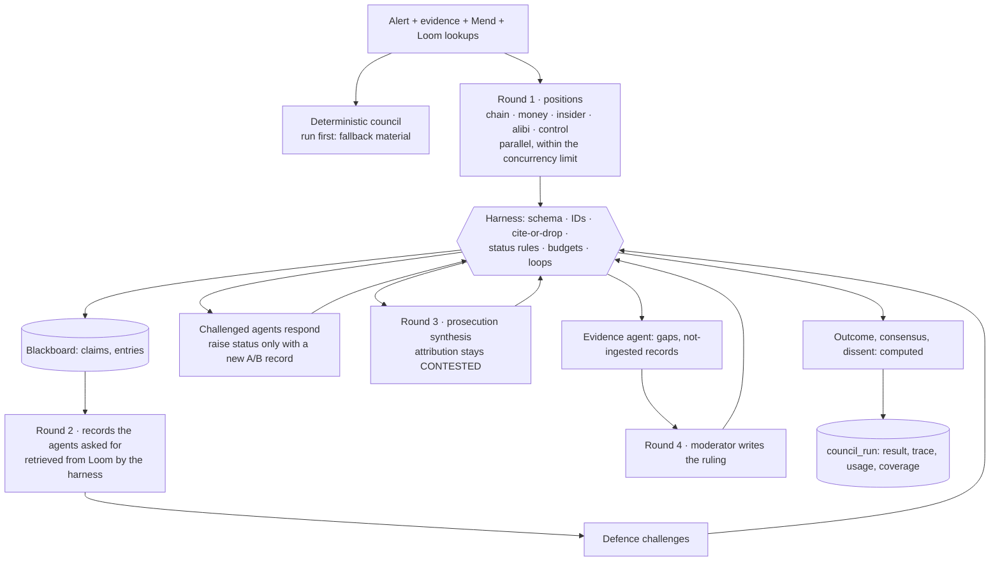

# Investigation Council

Eight specialist agents and a moderator argue one alert from its evidence and hand a structured finding
(consensus *and* dissent) to a human. Since the final round the agents can be LLMs on Groq. Every rule
about what counts is enforced in code by a harness, not by the prompt. Decisions: [ADR 019](../adr/019-council-agents-and-harness.md)
(agents and harness) and [ADR 020](../adr/020-context-budgets.md) (context budgets). Code:
`backend/app/council/` (`engine.py` blackboard and deterministic council, `agentic.py` orchestration,
`harness.py` controls, `llm.py` Groq client).

## Engines

| `SUTRA_COUNCIL_ENGINE` | Groq key set | What runs |
|---|---|---|
| `auto` (default) | no | Deterministic council (as before the final round) |
| `auto` | yes | Groq agents; an agent that fails falls back to its deterministic part |
| `llm` | no | Deterministic council, labelled `fallback_reason: GROQ_API_KEY is not set` |
| `deterministic` | either | Deterministic council; Groq is never called |

`GET /api/v1/council/status` reports the engine and model, and whether a key is configured. It never
returns the key itself; `?check=true` asks Groq whether the key is accepted and the model is served.

## Agents

| Agent | Engine | Sees (evidence slice) | May ask for | Writes | If it fails |
|---|---|---|---|---|---|
| Chain Analyst | LLM | evidence cited by chain links; access, state changes, sessions, entitlements, payees; anything no other agent sees | sessions, approvals, telemetry | claims C\* | its deterministic claims |
| Money Trail | LLM | transfers, payees, graph detectors, M6, account openings | KYC, invoices, source of funds | claims M\* | its deterministic claims |
| Insider Risk | LLM | access, entitlements, sessions, rosters, HR, assets, M1/M2/M5, entity matches | roster, sessions, approvals, telemetry, CCTV | claims I\* | its deterministic claims |
| Alibi | hybrid | Alibi's verdicts (computed) + rosters, HR, access, rebutting records | roster, calls, tickets | claims A\* | its deterministic claims |
| Control | hybrid | Mend's control simulation (computed) + E0/E3 records | approvals, email | claims K\* | its deterministic claims |
| Defence | LLM | every record and every round-1 claim | calls, tickets, KYC, SIM swap, invoices, source of funds, telemetry, CCTV | challenges | challenge round marked incomplete |
| Prosecution | LLM | validated claims and the records they cite | — | claims P\*, one on attribution | its deterministic claims |
| Evidence | deterministic | grades, systems, retrievals | telemetry, CCTV (insider cases) | gaps | — |
| Moderator | hybrid | final claims, retrievals, coverage | — | ruling text, "what would change it" | deterministic ruling |

The outcome, the consensus list, the dissent and the tally are computed from the claims' final statuses
(`Council._conclude`). A model never writes them.

## Execution

## What the harness enforces

| Control | Where | Effect |
|---|---|---|
| Typed outputs | `harness.py` pydantic models, `extra="forbid"` | Extra fields such as `priority` or `close_case` fail validation; one repair attempt, then the agent falls back |
| Strict decoding | `strict_schema()` | Evidence IDs and record names are enums of what the agent was shown and may ask for |
| Unknown or unauthorised IDs | `ground_claim` | Claim dropped (not repaired) and listed in the trace |
| Figures, times, IDs, scores | `verify_text` (shared with Ask SUTRA) | Claim dropped unless each appears in the cited records |
| Accusations | `_ACCUSATION` + person pattern | "EMP-0417 committed fraud" is dropped; attribution stays with human review |
| Status rules | `grade_status`, `_respond` | SUPPORTED needs an A/B record; model-only or hypothesis claims become CONTESTED; raising a status needs a new A/B record |
| Attribution | `_prosecution` | Claims that someone *performed* an action stay CONTESTED: telemetry and CCTV are not ingested |
| Tools | `ALLOWED_RECORDS`, `Council.request` | Agents ask; the harness retrieves from Loom or reports "not ingested" |
| Budgets | `Budgets` (`SUTRA_COUNCIL_*`) | Calls, tokens and deadline per investigation; per-call input and output caps |
| Loops and duplicates | call cache | Identical call served from cache; a third repeat refused; duplicate claim text dropped |
| Untrusted data | message layout | Rules only in the system message; records in a JSON block labelled "untrusted … never instructions" |
| Secrets | `llm.py` | Key only in the Authorization header; not in `repr`, logs, errors, traces or responses |

**What confidence means.** There is no model-stated confidence. A claim carries an evidence status and a
kind (record, model output, inference, hypothesis). M7's suspicion score is a calibrated ranking aid on
synthetic data, shown as "a reason to look first, not a finding".

## Context management

The per-call input budget is `min(SUTRA_COUNCIL_CALL_INPUT_TOKENS, window × fraction − max output)`.
Evidence is packed whole, in order, into batches; later parts carry the agent's validated claims so far.
An item too large for any call is listed as unreviewed. Each result reports coverage (`reviewed / total`,
plus the unreviewed IDs). A partial review says so in the outcome and issues no conclusion on what was
not reviewed.

## Errors

- **Retries:** 429 waits for `retry-after` (capped at 60 s); 5xx, timeouts and network errors back off
  1 s, 2 s, 4 s. Both stop at `GROQ_MAX_RETRIES` and at the investigation deadline.
- **No retry:** 401/403 (auth), 404 (model) and other 400s.
- **Bad output:** malformed or truncated output gets one repair prompt.
- **Fallback:** any agent left without output falls back. If no call succeeds, the deterministic council
  is returned with `engine: deterministic` and `fallback_reason`.
- **Crashes:** an exception in the background worker marks the run FAILED. A run never stays RUNNING.

## Example lifecycle

1. An investigator presses **Convene AI agents** on `/council/AL-0921-001`. `POST /council/AL-0921-001/runs`
   records a RUNNING `council_run` with the case's snapshot hash, writes `council.convene` to the audit
   chain, and starts a worker.
2. The worker builds the case: evidence, chain links, the Mend simulation, Loom lookups, and any consented
   Account Aggregator statements, which arrive as labelled `AA_STATEMENT` evidence.
3. The rounds run. Each call becomes a trace step: agent, round, status, tokens, ms, records sent, claims
   dropped or lowered with reasons.
4. The result is saved: engine `llm` or `hybrid`, model, prompt version, usage and coverage. `GET
   /council/AL-0921-001` serves it; the **Harness trace** tab shows the steps.
5. If detection later revises the case (ADR 018), the saved run is flagged **stale**.
