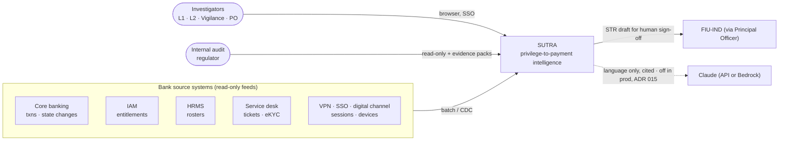
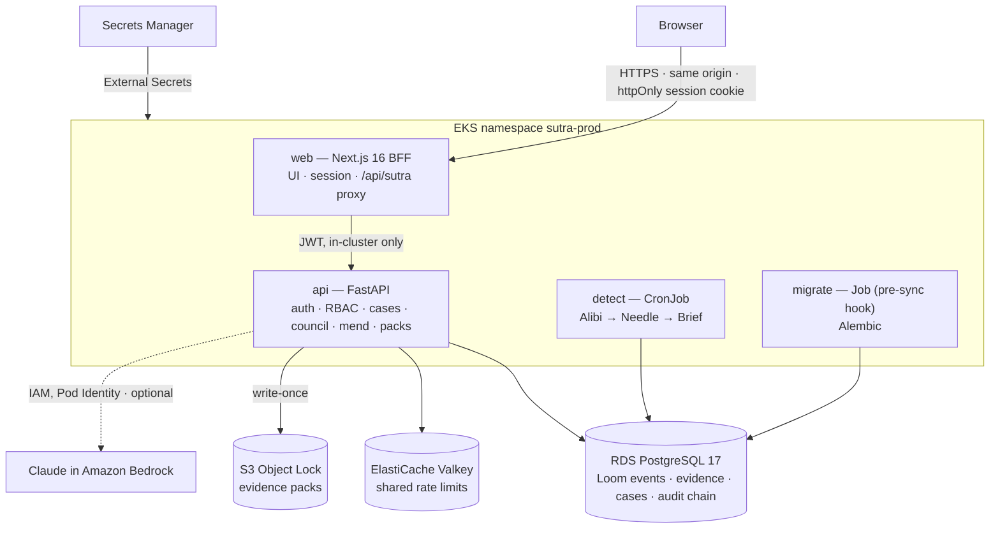
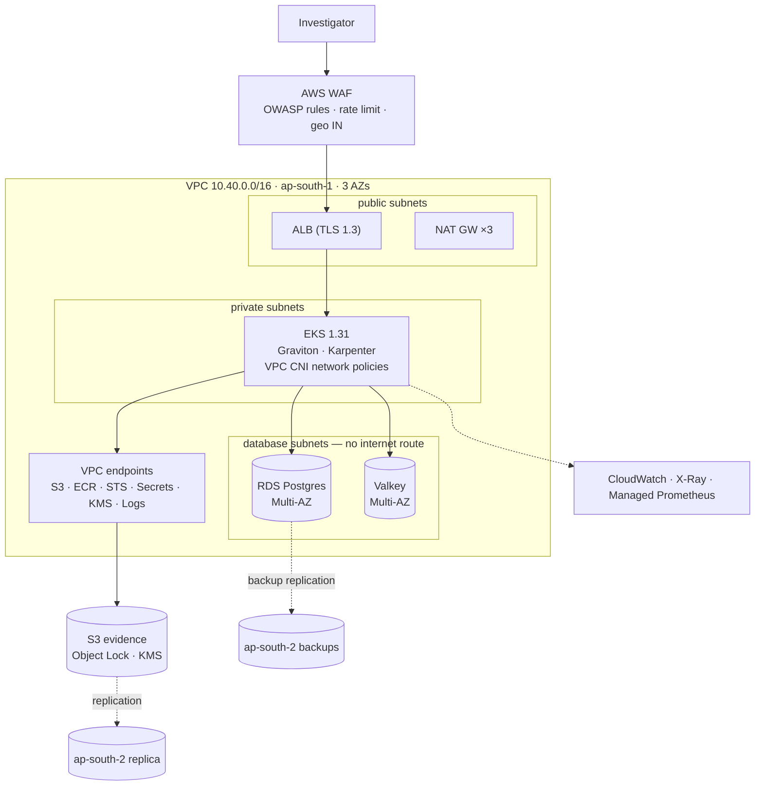
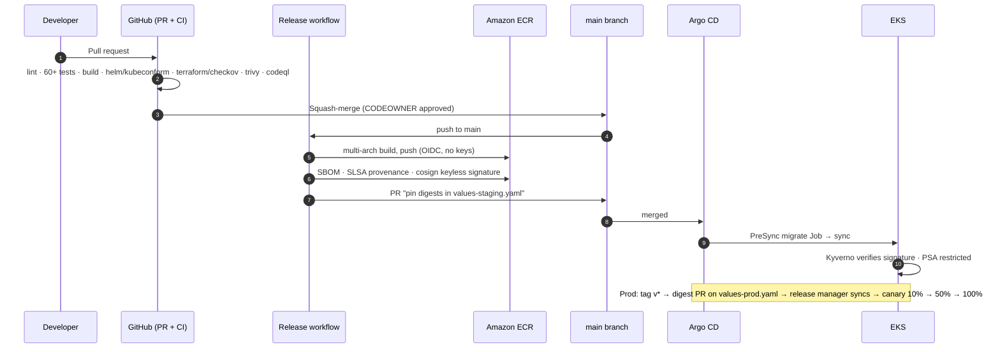

# Architecture

SUTRA in four views: the system in its context, the containers inside it, how it is deployed on
AWS, and how a release travels from a commit to production. Diagrams are Mermaid and render on GitHub.

## 1. Context

Who uses SUTRA and which bank systems it reads. SUTRA is read-only towards source systems:
it never changes an account, a privilege or a payment.



## 2. Containers



Inside `api` the code is a modular monolith ([ADR 001](../adr/001-modular-monolith.md)):

| Module | Role |
|---|---|
| `loom` | Bitemporal event store, entity resolution, frames for the pipeline |
| `needle` | 22 detectors (rules R1–R10, models M1/M2/M5/M6, graph G1–G5, ER) and chain assembly |
| `alibi` | Five explanation templates per staff access → EXPLAINED / PARTIAL / UNEXPLAINED |
| `brief` | Evidence book, 7 dimensions, priority lattice, prosecution and defence argument |
| `mend` | Counterfactual controls C1–C8 with friction measured on 90 days of history |
| `council` | Eight adversarial agents + moderator over Loom records |
| `copilot` | Cited answers and STR drafts; cite-or-drop verifier; deterministic fallback |
| `api` | HTTP surface, RBAC, four-eyes and two-person rules, hash-chained audit |

## 3. Deployment on AWS



Infrastructure is Terraform in [`infra/terraform`](../../infra/terraform): one module
(`modules/sutra`) composed per environment (`envs/staging`, `envs/prod`).

## 4. Release flow



## 5. Request path for one investigator click

1. The browser calls `/api/sutra/alerts/AL-0921-001` on the **same origin** — there is no API URL in the browser.
2. The Next.js route handler reads the httpOnly session cookie, attaches the JWT and forwards to the API inside the cluster.
3. FastAPI authenticates the token, checks the capability (`require("alerts:read")`), and reads Loom.
4. The response carries `X-Request-ID`; the same ID is on the API log line and the trace span.
5. Privileged actions (case view, decision, unmask, pack) append an entry to the hash-chained audit log in the same transaction.

## 6. The live demo path

What happens when **Play** is pressed on Live Ops ([ADR 016](../adr/016-live-feed-demo.md)). Demo mode only.

```mermaid
sequenceDiagram
  autonumber
  participant UI as Live Ops (browser)
  participant BFF as Next.js BFF
  participant API as FastAPI /live
  participant W as Run worker
  participant PG as Postgres (Loom)
  UI->>BFF: POST /api/sutra/live/runs {speed}
  BFF->>API: POST /api/v1/live/runs (JWT)
  API->>W: start (one run at a time)
  API-->>UI: 202 {run_id}
  UI->>BFF: EventSource …/live/runs/{id}/events
  loop each held-back row, in time order
    W->>PG: INSERT row + apply its effects (one transaction)
    W-->>UI: event {t, source system, summary}
  end
  W->>PG: read the 90-day window
  W->>W: Alibi → signals → Needle → Brief (a stage event each)
  W->>PG: persist — one transaction; IDs, triage and cases kept
  W-->>UI: alert · alibi verdicts · done {ground truth, scenario checks}
```

Reset runs the same worker in reverse: undo the ingested rows newest-first, remove the alerts the
feed created (recorded in the audit chain), and re-detect.
