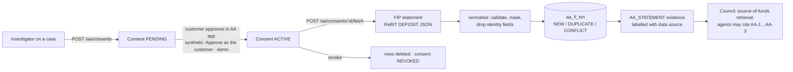

# Account Aggregator

**Status:**
- Implemented and tested with a labelled **synthetic** FIP.
- Setu **sandbox** adapter written and tested against recorded response shapes, but **not** run against
  Setu: no credentials.
- **Live** customer data: **blocked** (needs a regulated, certified FIU).

Decision record: [ADR 023](../adr/023-account-aggregator.md).

## Feasibility

| Question | Answer | Source |
|---|---|---|
| Did SUTRA have an AA connector before the final round? | No | repository audit |
| Who may receive live AA data? | A Financial Information User regulated by RBI, SEBI, IRDAI or PFRDA, certified by a Sahamati-empanelled certifier, listed in the live Central Registry, and also willing to act as an FIP (reciprocity) | [Sahamati: joining the AA network](https://sahamati.org.in/?p=3007), [Setu: FIU go-live](https://docs.setu.co/data/account-aggregator/licenses-and-go-live/go-live) |
| Is there a sandbox? | Yes. Setu's Bridge issues sandbox credentials, with mock data for all FI types, the real consent screens, and `POST /consents` → approve → `POST /sessions` → `GET /sessions/:id` | [Setu quickstart](https://docs.setu.co/data/account-aggregator/v1/quickstart), [consent flow](https://docs.setu.co/data/account-aggregator/v1/api-integration/consent-flow), [data APIs](https://docs.setu.co/data/account-aggregator/v1/api-integration/data-apis) |
| What data shape? | ReBIT DEPOSIT: Account → Profile, Summary, Transactions. Transaction fields `type` (CREDIT/DEBIT), `mode` (CASH/ATM/CARD/UPI/FT/OTHERS), `amount`, `currentBalance`, `transactionTimestamp`, `valueDate`, `txnId`, `narration`, `reference` | [ReBIT deposit schema](https://specifications.rebit.org.in/api_schema/account_aggregator/documentation/deposit.html) |
| Does an API key alone give access to real accounts? | No. Real data flows only under a customer's consent, to a certified FIU | as above |
| Feasible within the hackathon? | Synthetic FIP: yes, done. Sandbox: yes, if the team registers on Setu's Bridge. Live: no | — |

**Why not use a teammate's real bank statement?** It contains no fraud, so it cannot show detection
working. It would also put a real person's financial data into a project whose privacy position is
"100% synthetic".

## What it does in SUTRA

The AA is a **data source for an investigation**, not a second detection engine. Its job is a
customer-consented source-of-funds check: the "source-of-funds declaration" record the Council used to
report as *not ingested*.



- **Data source on everything:** every consent, row, evidence item and API response carries
  `SYNTHETIC_DEMO`, `SANDBOX` or `LIVE`. Synthetic evidence summaries start with "[synthetic demo data]".
- **Not fed to M1–M7:** they were fitted on the bank's own records; another bank's statement is a
  population they were never validated on.
- **Evidence items:**
  - AA-1: statement totals.
  - AA-2: largest credit and its narration.
  - AA-3: whether the customer's Kestrel cash deposits were preceded, within 6 h, by cash withdrawals of a
    similar amount from the consented account (the structuring question).

## API (`/api/v1/aa`)

| Method | Path | Who | Notes |
|---|---|---|---|
| GET | `/status` | `cases:read` | provider, data source, retention |
| POST | `/consents` | `cases:investigate` | `{customer_id, alert_id?, months (1–24), purpose}` |
| GET | `/consents?customer_id=` | `cases:read` | |
| POST | `/consents/{id}/approve` | `cases:investigate` | **synthetic only**: stands in for the customer's approval |
| POST | `/consents/{id}/fetch` | `cases:investigate` | 409 unless ACTIVE; returns outcomes and rejected rows with reasons |
| POST | `/consents/{id}/revoke` | `cases:investigate` | deletes fetched rows |
| GET | `/consents/{id}/transactions` | `cases:read` | normalised rows |

The synthetic provider answers only when `SUTRA_DEMO_MODE=true`, which staging and production refuse.

## Normalised schema (`aa_fi_txn`)

| Field | Notes |
|---|---|
| `id` | `AAT-` + hash(FIP, masked account, txnId): stable, so re-fetching the same statement is idempotent |
| `fip_id`, `masked_account` | Never a full account number. Long digit runs in narrations are masked too |
| `txn_id`, `txn_type`, `mode` | ReBIT enums enforced; anything else is rejected with a reason |
| `amount_paise`, `balance_paise` | Integer paise; non-positive or non-finite amounts are rejected |
| `occurred_at`, `value_date` | Timestamps must carry a time zone |
| `narration`, `reference` | Control characters stripped, 200 characters max |
| `data_source`, `content_sha256`, `fetched_at` | Provenance |

**Profile fields (name, mobile, email, PAN, date of birth) are not stored.**

## Security and consent

- **Consent first:** nothing is fetched before ACTIVE. Revocation purges the data, and data expires
  after `SUTRA_AA_DATA_LIFE_DAYS` (default 30).
- **Server-side credentials:** Setu credentials are server-side only (`SUTRA_AA_SETU_*`, `repr=False`)
  and never in `frontend/`. Transport is https only.
- **Audit:** every action is in the hash-chained log (`aa.consent.create`, `aa.consent.approve_synthetic`,
  `aa.fetch`, `aa.consent.revoke`).
- **Out of scope (BLOCKED or PENDING):** AA payload encryption (ECDH key exchange) is handled by the TSP
  in Setu's model and not by SUTRA. A production FIU would also need encryption at rest for `aa_fi_txn`
  (RDS KMS is already in the Terraform), a DPDP Act consent notice, and grievance handling.

## Configuration

```bash
SUTRA_AA_PROVIDER=synthetic          # or setu
SUTRA_AA_SETU_BASE_URL=              # from Setu's Bridge
SUTRA_AA_SETU_CLIENT_ID=
SUTRA_AA_SETU_CLIENT_SECRET=
SUTRA_AA_SETU_PRODUCT_INSTANCE_ID=
SUTRA_AA_DATA_LIFE_DAYS=30
```

## Demo script (2 minutes)

1. Open a case whose chain has a customer account, e.g. `/cases/AL-0918-001` (cash structuring).
2. In **Account Aggregator**, point at the amber **Synthetic demo data** badge. Say: "This is the consent
   flow a bank uses under RBI's AA framework. The FIP here is fictional; live data needs a licensed FIU."
3. **Request consent** → **Approve as the customer (demo)** → **Fetch statement**. The panel reports rows
   new, already held and conflicting.
4. Press **Fetch statement** again: every row reports as already held.
5. Open the **Council**. The source-of-funds request now reads RETRIEVED and cites AA-1…AA-3.
6. **Revoke**: the rows are deleted, and the Council's source-of-funds request reads "consent … was
   revoked; its statement was deleted".

## Remaining work

| Item | Status | Needs |
|---|---|---|
| Run against Setu's sandbox | BLOCKED | Bridge credentials; confirm header names and purpose code against Setu's Postman collection and ReBIT's purpose list |
| Consent status webhooks (Setu notifications) | PENDING | A public HTTPS endpoint |
| Live data | BLOCKED | Regulated, certified FIU |
| Statement data in detection models | Not planned | Labelled external-statement data to validate on |
