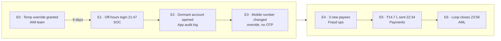
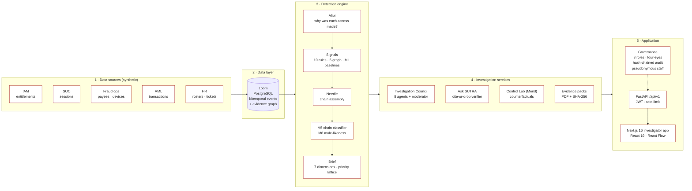
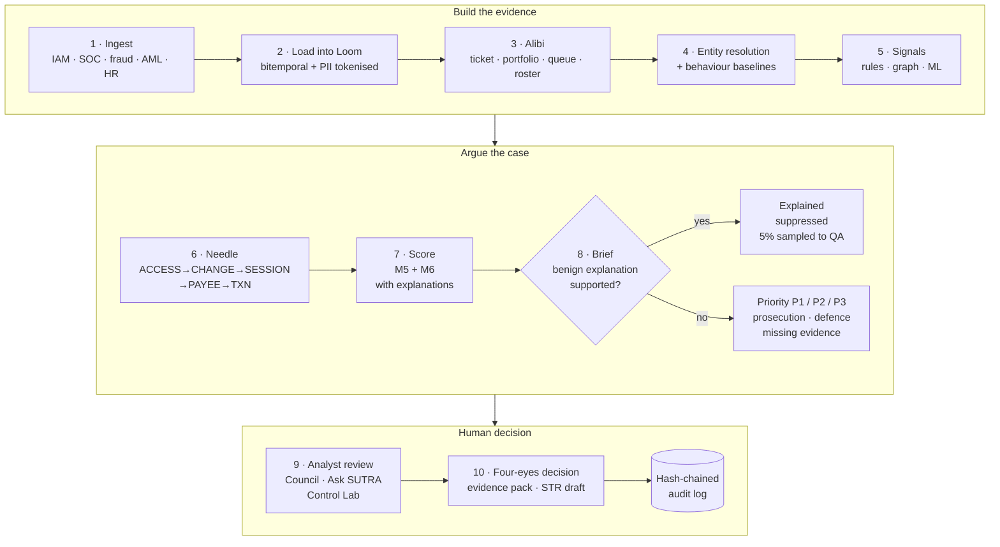
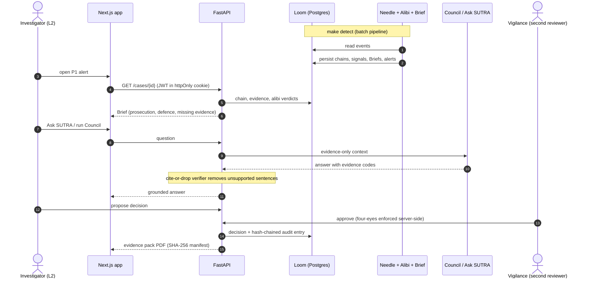
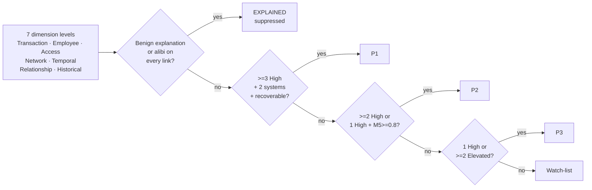
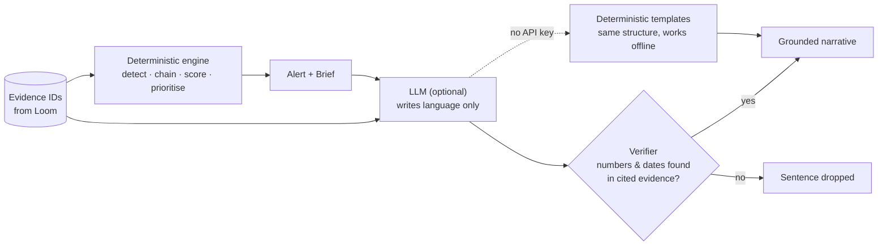

# SUTRA: HackMatrix 5.0 PPT content (Team Admiral)

Template order: 1 Title · 2 Abstract · 3 Idea Title · 4 Technical Approach · 5 Feasibility & Viability · 6 Impact & Benefits · 7 Research & References.
Diagram PNGs (3× resolution, white background, template-red) are in `docs/ppt/diagrams/`. The `.mmd` sources are the same diagrams as the Mermaid blocks below.

Rule for every slide: max 5–6 bullets, one line each. Put detail in your speech, not on the slide.

---

## Slide 1: Title (already filled)

Suggested addition under the title: **SUTRA: privilege-to-payment intelligence** (सूत्र = "thread")

---

## Slide 2: ABSTRACT

- Insider-enabled fraud looks harmless to every team on its own: IAM sees a forgotten override, SOC an off-hours login, fraud ops a phone change, AML a payment loop.
- **SUTRA** rebuilds the whole time-ordered chain from *privileged access → account change → payment → layering* in one view.
- It checks *why* each access happened (ticket, portfolio, queue, roster), so legitimate work is not flagged.
- Every alert is an argument with prosecution, defence and missing evidence, and **never a black-box score**.
- Demo case: ₹14.7 L leaves **47 minutes** after the first access, enabled by a privilege granted 9.5 days earlier.

**Diagram to place:** `01-problem-chain.png`

---

## Slide 3: IDEA TITLE

**SUTRA: privilege-to-payment intelligence for financial-crime and insider-risk investigation**
*Trace every rupee back to the privileged action that made it possible, and argue both sides before an analyst opens the case.*

Five core ideas:

- 🧵 **Needle:** automatic chain assembly across IAM, SOC, fraud-ops and AML data.
- 🧾 **Alibi Ledger:** explains each staff access with a real work reason: `EXPLAINED` · `PARTIAL` · `UNEXPLAINED`.
- ⚖️ **Brief:** 7 dimensions, supporting *and* contradicting evidence, priority from readable rules.
- 🏛️ **Investigation Council:** 8 specialist agents plus a moderator; a human makes the final call.
- 🛡️ **Control Lab (Mend):** the cheapest control that would have broken the chain, and its cost to normal operations.

**Differentiator line (say it out loud):** existing tools link *entities* (who is connected to whom). SUTRA investigates the *ordered chain* and the *reason* behind each step.

---

## Slide 4: TECHNICAL APPROACH

Put the architecture diagram on the left/centre and 5 bullets beside it.

- **Data:** Loom, a bitemporal PostgreSQL event store (valid time + system time) with the evidence graph; PII tokenised at ingest.
- **Detection:** 10 rules (R1–R10), 5 graph detectors (G1–G5: cycles, pass-through, fan-in/out, mule factory, shared identifiers), behavioural baselines (M1, M2), entity resolution.
- **Chains:** grammar `ACCESS → CHANGE → SESSION → PAYEE → TXN → TXN*`, Δt ≤ 72 h per hop.
- **Models (glass-box):** M5 logistic regression (exact per-feature contributions) and M6 LightGBM (TreeSHAP).
- **Priority:** 7 dimensions → P1/P2/P3/Watch by readable rules (no single score).
- **LLM boundary:** the LLM writes language only, and a cite-or-drop verifier removes any sentence not backed by evidence. It works offline with templates.
- **Stack:** FastAPI · SQLAlchemy · PostgreSQL · pandas/NetworkX/scikit-learn/LightGBM · Next.js 16 · React 19 · Tailwind v4 · React Flow.

### Diagram A: System architecture (`02-system-architecture.png`)

### Diagram B: System workflow (`03-system-workflow.png`)

### Diagram C (optional, backup slide): Investigator sequence (`04-investigation-sequence.png`)

### Diagram D (optional): Priority without a score (`05-priority-lattice.png`)

### Diagram E (optional): LLM boundary (`06-llm-boundary.png`)

---

## Slide 5: FEASIBILITY AND VIABILITY

**Feasible (built and running):**

- Working end-to-end prototype: `make demo` seeds data, trains the models and runs detection; API and web app run locally.
- Low-cost deployment: Docker + PostgreSQL, one FastAPI modular monolith (no microservices, no GPU needed).
- Synthetic-data validation: **14/14 scenario checks pass, 8/8 legitimate twins stay quiet** (suspicious case + look-alike innocent twin per scenario).
- Runs **offline**: the LLM is optional, and deterministic templates give the same structure.
- Regulator-aligned: RBI Master Directions on Fraud Risk Management (2024) already require data analytics, early-warning signals and staff-accountability reviews.

**Viable (why it can sustain):**

- **Target market:** mid-size and co-operative banks, NBFCs first (India has 1,457 urban co-operative banks) and Tier-1 later. Enterprise suites are too heavy for them.
- **Fits alongside** RBI MuleHunter.AI, using its mule score as an input signal.
- **Scale path:** Needle becomes a stream processor keyed by account, and the API scales horizontally unchanged (ADR 001, ADR 006).

**Honest limits (judges respect this):** all data and metrics are synthetic, so accuracy on real bank data is unproven. Near-real-time in the MVP (micro-batch), streaming at scale. It is decision support and does not accuse anyone; every conclusion goes to human review.

**Roadmap strip:** MVP (now) → pilot on real bank data with a co-operative bank → streaming ingestion → Tier-1 integrations.

---

## Slide 6: IMPACT AND BENEFITS

**Problem size (cite on slide):**

- ₹36,014 cr of bank fraud reported in India in FY25, about 3× FY24 (RBI).
- Median time to detect occupational fraud is 12 months (ACFE 2026).
- 90–95% of transaction-monitoring alerts are false positives; analysts spend 3–6 h per case correlating 10+ systems (industry estimate / vendor claim).
- Real cases show the pattern: Operation Octopus 2.0 (32 of 52 arrested were bank staff), TD Bank (US$3.09 B in penalties), PNB/Nirav Modi (₹13,850 cr).

**What SUTRA delivers:**

| For | Benefit |
|---|---|
| **Investigators** | One timeline instead of stitching logs from 10+ systems; evidence-backed argument instead of a bare score |
| **Banks** | Fewer false positives (alibi-explained access is suppressed, 5% sampled to QA); faster response while funds are still recoverable |
| **Compliance / Principal Officer** | STR drafts, 11-section evidence packs with SHA-256 manifest, tamper-evident audit log |
| **Risk / IAM teams** | Control Lab shows which control would have broken the chain and its cost to normal operations |
| **Staff & customers** | Pseudonymous by default, two-person unmask, and legitimate work is not accused |

**Responsible AI (one line):** the LLM never scores or closes an alert, every sentence cites evidence, four-eyes review is enforced by the API, and the decision stays with a human.

**Social impact:** protects pensioners and dormant-account holders, the typical victims of insider takeover and mule accounts.

---

## Slide 7: RESEARCH AND REFERENCES

Keep this to sources you can defend, and label them fact vs vendor claim.

- RBI: Master Directions on Fraud Risk Management (July 2024); FY25 fraud data (₹36,014 cr, 23,953 cases)
- RBI MuleHunter.AI (live in 31 banks); DoT Financial Fraud Risk Indicator (June 2025)
- ACFE Report to the Nations 2026 (median detection: 12 months)
- LexisNexis True Cost of Financial Crime Compliance (2023): US$206 B
- Ponemon / DTEX Cost of Insider Risks (2026 report): US$19.5 M average
- Cases: TD Bank US penalties (2024–26); PNB / Nirav Modi LoU fraud (2018); Operation Octopus 2.0 (2026)
- Market: NICE Actimize (Employee Fraud, SURVEIL-X), Quantexa (Internal Fraud), Clari5 EFRM, Feedzai, BioCatch, ComplyAdvantage
- Method: explanation-based auditing of EHR access (hospital "explained access" research), adapted for banking as Alibi
- Repo: github.com/rokadepiyush49-rgb/HackMatrix-Hackathon
- Full numbered source list: the SUTRA Blueprint artifact (§ Sources), https://claude.ai/artifact/KcXwD91M2o8KD11JnK1U9m

> Correction to carry into the pitch: linking employees to transactions is *not* an empty space. Quantexa and NICE sell insider-fraud products, so do **not** say "nobody connects insiders to money". Say the gap is the ordered chain plus the reason behind each access.
